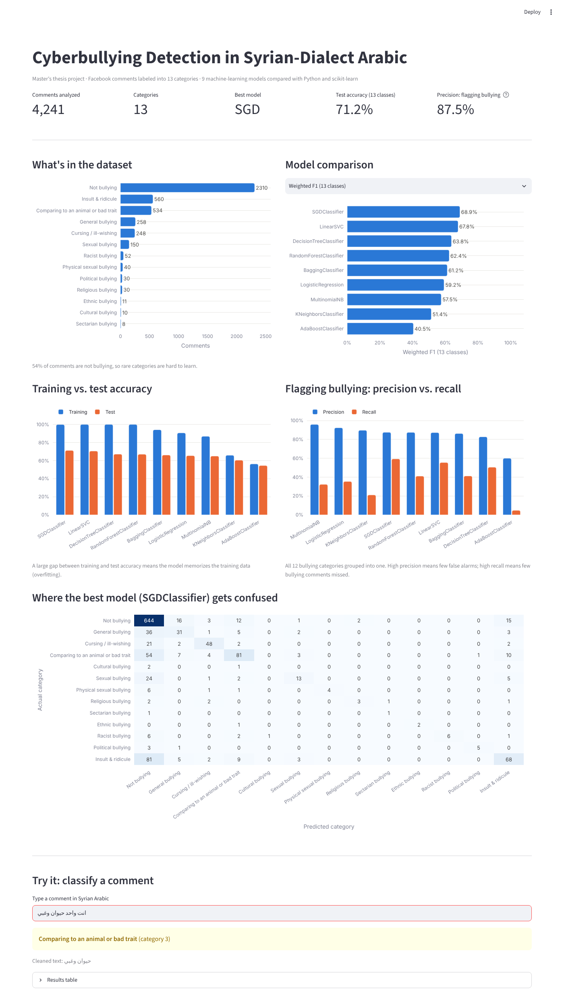

# Cyberbullying Detection in Syrian-Dialect Arabic

Machine-learning models that detect and classify cyberbullying in Facebook comments written in **Syrian-dialect Arabic**, plus an interactive **Streamlit dashboard** to explore the results and test new comments.

This was my **M.S. in Web Science thesis project** (Syrian Virtual University). Most Arabic NLP tools target Modern Standard Arabic, while social media users write in dialect and slang. This project builds a dialect-specific cleaning pipeline and compares nine classifiers.



## Key results

| | |
|---|---|
| Comments analyzed | **4,241** |
| Categories | **13** (not bullying + 12 bullying types) |
| Models compared | **9** |
| Best model (13 classes) | **SGDClassifier**: 71.2% accuracy, 68.9% weighted F1 |
| Flagging bullying vs. not bullying | **87.5% precision** with the best model; up to **95.9%** with Multinomial Naive Bayes |

**What I learned from the results**
- **Class imbalance matters.** 54% of comments are not bullying, and some categories have fewer than 15 examples. Models do well on large categories and poorly on rare ones, which is why macro F1 is much lower than weighted F1.
- **Overfitting.** Tree models and linear SVMs reach ~99.9% training accuracy but ~70% test accuracy.
- **Precision vs. recall trade-off.** Naive Bayes rarely raises a false alarm (95.9% precision) but misses many bullying comments (32% recall). SGD gives a better balance.

## Bullying categories

| Label | Category | Label | Category |
|---|---|---|---|
| 0 | Not bullying | 7 | Religious |
| 1 | General bullying | 8 | Sectarian |
| 2 | Cursing / ill-wishing | 9 | Ethnic |
| 3 | Comparing to an animal or bad trait | 10 | Racist |
| 4 | Cultural | 11 | Political |
| 5 | Sexual | 12 | Insult & ridicule |
| 6 | Physical sexual | | |

## How it works

1. **Text cleaning for dialect Arabic** (`preprocessing.py`): remove diacritics, URLs, digits, mentions, punctuation, emoji and Latin letters; normalize alif, hamza, ya and ta marbuta; collapse repeated letters (e.g. ههههه); apply a custom Syrian-slang stemming dictionary and stop-word list.
2. **Features**: bag-of-words with `CountVectorizer` (8,503 words).
3. **Models** (`train.py`): Multinomial Naive Bayes, Decision Tree, Linear SVC, AdaBoost, Random Forest, Bagging, Logistic Regression, SGD and K-Nearest Neighbors. 70/30 stratified train/test split.
4. **Evaluation**: accuracy, weighted and macro precision/recall/F1, a binary bullying-vs-not view, and a confusion matrix.
5. **Dashboard** (`app.py`): model comparison, dataset breakdown, overfitting check, confusion matrix, and a live box to classify any comment.

## Tech stack

Python · pandas · scikit-learn · Plotly · Streamlit · Jupyter / Google Colab

## Run it yourself

```bash
git clone https://github.com/reem-1989/cyberbullying-detection-syrian-dialect.git
cd cyberbullying-detection-syrian-dialect
pip install -r requirements.txt
streamlit run app.py
```

The trained model and results are included, so the dashboard runs without the raw data. To re-train, put `cyberbullying.xlsx` in `data/` and run `python train.py`.

## Project structure

```
├── app.py                 # Streamlit dashboard
├── train.py               # trains and compares the 9 models
├── preprocessing.py       # Arabic dialect text cleaning
├── results/               # metrics, class distribution, confusion matrix
├── models/                # trained vectorizer and best model
├── notebooks/             # original thesis notebook (Google Colab)
└── data/                  # dataset (not published)
```

## Author

**Reem Ali** · Data Analyst · [LinkedIn](https://www.linkedin.com/in/reem-ali-8547229b) · [GitHub](https://github.com/reem-1989)
